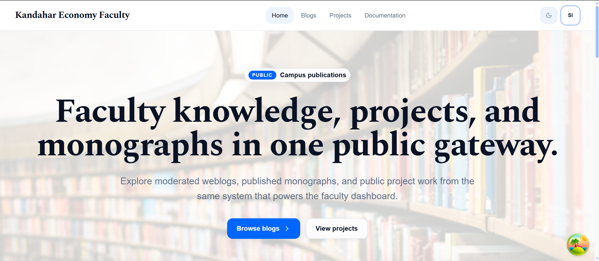
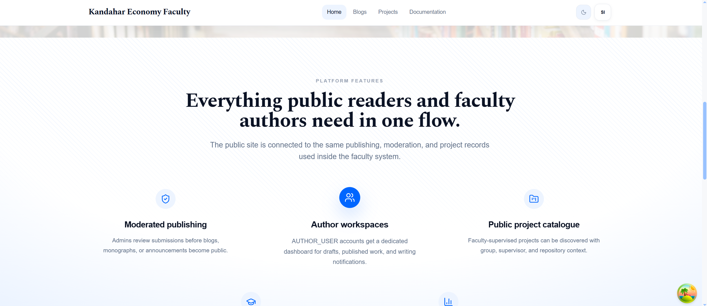
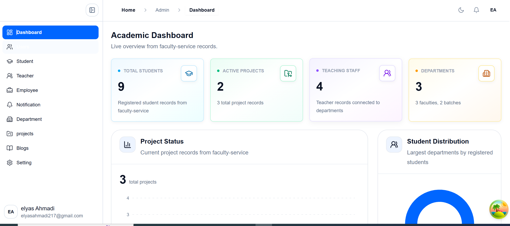
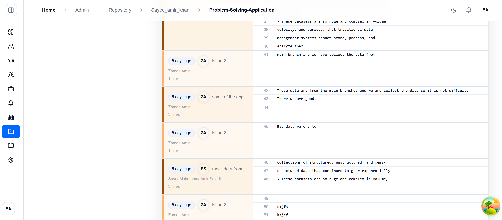
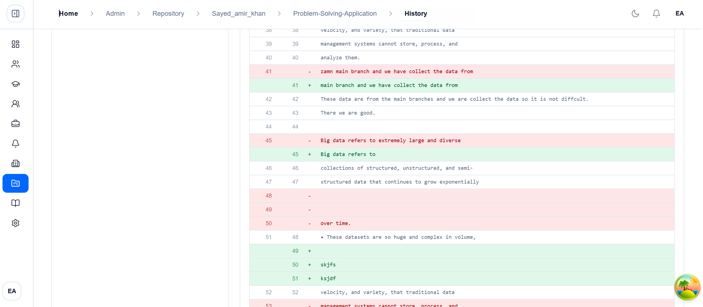
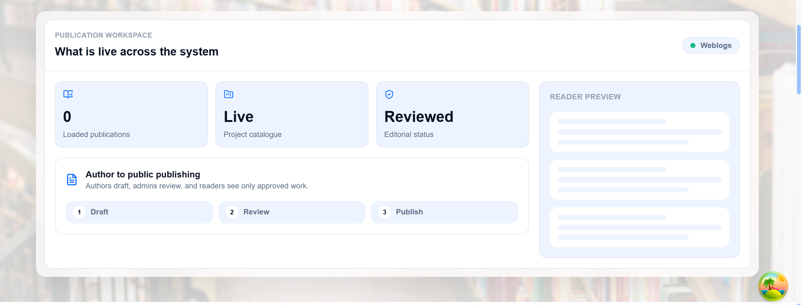
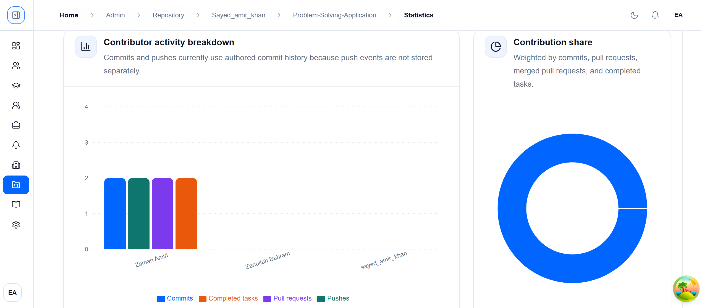

# Simple Collaboration Environment for Final Year Project

A modern, web-based collaboration and project management platform for supervising, developing, and publishing final-year projects inside a university faculty.

---

## About EDH-Technalogy

**EDH-Technalogy** is a professional software development team focused on building modern, scalable, and practical digital solutions for organizations, businesses, and institutions.

We design and develop web applications, business management systems, dashboards, automation tools, AI integrations, and digital solutions that solve real operational problems.

All projects delivered by **EDH-Technalogy** are designed, developed, tested, and maintained with a strong focus on usability, performance, security, maintainability, and practical business value.

---

## Project Overview

| Item                  | Details                                                                        |
| --------------------- | ------------------------------------------------------------------------------ |
| **Project Name**      | Simple Collaboration Environment for Final Year Project                        |
| **Project Type**      | Web, Desktop, and CLI — SPA frontend + microservices backend + Go CLI/Desktop  |
| **Client / Industry** | University Faculty / Higher Education                                          |
| **Main Purpose**      | Final-year project collaboration, version control, management, and publication |
| **Development Team**  | EDH-Technalogy                                                                 |
| **Repository**        | (This folder contains the Front-End application)                               |
| **Demo Link**         | Coming Soon                                                                    |

---

## Project Description

Simple Collaboration Environment for Final Year Project is a software system designed for managing and supporting final-year projects inside a specific faculty of a university. The main purpose is to provide one connected environment where students, supervisors, and faculty administrators can manage academic projects, collaborate with team members, track project progress, review work, and publish final project results.

The system is inspired by Git and includes local version-control functionality (via the CLI and desktop app) plus a rich web-based management platform. Users can track changes locally, commit, clone, push, fetch, pull, and merge changes while the web platform supports user management, project registration, team workflows, notifications, blogs, public publishing, and administrative dashboards.

---

## Problem

Final-year projects typically involve students, supervisors, department staff, and faculty administrators. Many faculties still rely on manual workflows (paper forms, email, messaging apps) that lead to lost files, unclear contributions, overwritten work, and poor administrative visibility.

This project solves the need for a simpler, academic-focused collaboration environment that reduces friction for students and staff while retaining version-control safety and review workflows.

---

## Solution

The platform combines local version control (CLI + desktop), remote repository hosting, and a web management interface. Students work locally and sync with the remote server; supervisors and admins review, manage, and publish finished work. The microservice backend provides modular, maintainable services for auth, files, blogs, notifications, version control, and faculty data.

---

## Main Parts of the Project

1. Front-End Application
   - React + Vite single-page application for all user roles (administrator, student, teacher, author, staff, dean, public).
   - Handles authentication, role gating, dashboards, repository views, forms, and public pages.

2. Back-End Application
   - Microservices built with Spring Boot and Spring Cloud (config, discovery, gateway, auth, faculty, file, blog, notification, version-control).
   - MongoDB and PostgreSQL for storage, Redis for caching, Kafka/RabbitMQ for messaging, MinIO for object storage.

3. CLI and Desktop Application
   - CLI written in Go (Cobra) provides Git-like commands for local repo management: init, add, commit, clone, push, fetch, pull, merge, status, log.
   - Desktop app built with Wails wrapping the CLI logic in a graphical interface for non-terminal users.

---

## Front-End Description

The front-end is a modern SPA built with React and Vite. It communicates with the backend via the API Gateway. The UI uses Tailwind CSS, Radix UI, Lucide icons, Syncfusion components (document/spreadsheet/PDF features), TanStack Query, Axios, i18next for localization, and STOMP/SockJS for real-time updates.

Roles: `administrator`, `student`, `teacher`, `author`, `staff`, `dean`, and public visitors.

---

## Back-End Description

Key services:

- Config Service — centralized config
- Eureka — service discovery
- Gateway — API gateway and routing
- Auth Service — Keycloak, OAuth2, roles and permissions
- Faculty Service — students, teachers, groups, projects
- File Service — uploads/downloads and media storage
- Blog Service — articles, drafts, publishing
- Notification Service — in-app and email notifications
- Version-Control Service — repositories, commits, pull requests, merges, histories, stats

Technologies: Java 17, Spring Boot, Spring Cloud, Keycloak, PostgreSQL, MongoDB, Redis, Kafka, RabbitMQ, MinIO, Flyway, Resilience4j, Swagger/OpenAPI, WebSocket/STOMP.

---

## CLI Application Description

Go-based CLI for local collaboration (Cobra). It provides a simplified Git-like workflow targeted for final-year project users: init, add, commit, branch, clone, push, pull, fetch, merge, log, status, authentication, and remote configuration.

---

## Desktop Application Description

Built with Wails (React + Go). Uses the same core logic as the CLI but exposes a graphical interface for users who prefer a desktop app.

---

## Core Collaboration Flow

1. Create or join a project → repository created on server
2. Clone the repository locally using CLI or desktop
3. Work locally: add, edit, commit
4. Push changes to remote server
5. Teammates fetch/pull updates and merge branches as needed
6. Supervisors review via pull requests, tasks, milestones, file history
7. Notifications keep collaborators informed
8. Completed projects may be published to the public site

---

## Key Features

- Git-inspired local and remote collaboration (init, commit, clone, push, pull, fetch, merge)
- Repository browser and file history in the web UI
- Pull requests, merge conflict support and code review workflows
- Task and milestone management
- Role-based dashboards for administrators, students, teachers, authors, staff, and deans
- Student/group/project registration and supervision workflows
- Blog and article publishing
- Notifications (in-app, email, websocket delivery)
- File upload/download and object storage
- Centralized auth and Keycloak integration

---

## Technology Stack

Front-End:

- React, Vite, React Router, Tailwind CSS, Syncfusion, Radix UI, Lucide, Axios, TanStack Query, i18next, STOMP/SockJS

Back-End:

- Java 17, Spring Boot, Spring Cloud (Config, Eureka, Gateway), Keycloak, PostgreSQL, MongoDB, Redis, Kafka, RabbitMQ, MinIO, Flyway

CLI/Desktop:

- Go, Cobra, Wails

Infrastructure:

- Docker Compose, PostgreSQL, pgAdmin, Redis, Kafka, Zookeeper, RabbitMQ, Keycloak, MinIO, OnlyOffice, MongoDB

---

## Why This Architecture Was Chosen

The three-part architecture (CLI/Desktop, backend microservices, frontend SPA) isolates concerns and maps each client to its primary environment: local work (CLI/Desktop), server coordination and storage (backend), and management/visualization (frontend). Microservices enable independent development and scaling of discrete domains such as auth, version-control, and file storage.

---

## Project Goal

Provide a simple but complete collaboration environment for final-year projects inside a university faculty: version control, project supervision, team collaboration, administrative management, and project publication.

---

## Screenshots

Screenshots for the Front-End are stored in the `screenshot` folder. Below are example renderings using centered HTML image tags (this matches the visual layout used in the Kandahar example):

   

---

   
   

   
   

---

   
   

If any filenames differ, open the `screenshot` folder and update the paths above to match the exact filenames.

---

## Role of EDH-Technalogy

EDH-Technalogy was responsible for the design, development, testing, and documentation of this project, including frontend, backend microservices, CLI, desktop app, and deployment configurations.

---

## Result

A complete platform that improves collaboration, supervision, and publication of final-year projects. It reduces manual overhead, improves traceability of contributions, and provides a central place for faculty administrators to manage project workflows.

---

## Project Status

Active development. Front-End application lives in this folder. Back-End microservices and CLI/Desktop components are included in the repository root under `Back-End/` and `vic-desktop-application/` respectively. Live demo and public deployment details are planned.

---

## Developed By

**EDH-Technalogy**

Professional Software Development Team
